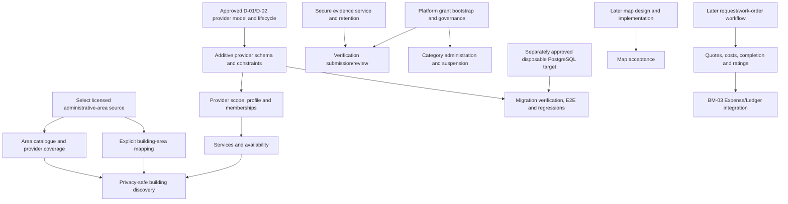

# BM-05 — Building Operations, Maintenance & Service Provider Network
## Building Management Platform
### Version 1.0 — Architecture & Implementation Baseline

---

## 1. Purpose

BM-05 establishes the operational and maintenance backbone of the Building Management Platform.

The central product objective is:

> **The building manager should not spend time searching for technicians, collecting phone numbers, comparing providers manually, or tracking maintenance requests through messages and spreadsheets.**

The platform should connect:

```text
Building
   ↓
Problem / Request
   ↓
Maintenance Workflow
   ↓
Service Provider Network
   ↓
Assignment
   ↓
Execution
   ↓
Verification
   ↓
Rating
   ↓
History
```

BM-05 builds on:

- BM-00 — Product Constitution
- BM-01 — Organization, Building & Unit Foundation
- BM-02 — Owners, Residents, Roles & Building Membership
- BM-03 — Finance, Monthly Charges & Ledger
- BM-04 — Payment Provider Integration & Reconciliation

---

# 2. Product Vision

The platform is not merely:

> "A building maintenance ticket system."

It is a **building services network**.

Two groups must exist:

### Demand

```text
Buildings
Managers
Owners
Residents
Tenants
```

### Supply

```text
Technicians
Companies
Cleaning services
Electricians
Plumbers
HVAC technicians
Elevator companies
Painters
Pest control
Security services
Other building service providers
```

The platform connects both sides while protecting privacy.

---

# 3. Critical Business Principle

The manager should not need to ask:

> "Do you know an electrician?"

Instead:

```text
Create Request
      ↓
Select Service Category
      ↓
System finds eligible providers
      ↓
Providers are ranked
      ↓
Request is assigned
      ↓
Provider contacts through platform
      ↓
Work completed
      ↓
Verification
      ↓
Rating
      ↓
History
```

---

# 4. Service Provider Network

A Service Provider may be:

- Individual technician
- Small service business
- Registered company
- Maintenance contractor
- Specialized engineering/service company

Recommended entity:

```text
ServiceProvider
----------------------------
Id
ProviderType
BusinessName
DisplayName
Status
VerificationStatus
CreatedAt
UpdatedAt
```

---

# 5. Provider Identity

The provider identity must be separate from:

- Phone number
- Individual technician
- Building
- Work order
- Rating

A provider may later have:

```text
Provider
├── Staff
├── Service Categories
├── Coverage Areas
├── Certifications
├── Ratings
├── Work History
└── Documents
```

---

# 6. Provider Types

Minimum:

```text
Individual
Company
Contractor
Specialist
```

Future types may be added.

---

# 7. Provider Registration

Provider onboarding should support:

```text
Register
 ↓
Profile
 ↓
Select Services
 ↓
Coverage Area
 ↓
Identity/Business Verification
 ↓
Review
 ↓
Active
```

Provider registration does not guarantee ranking or assignment.

---

# 8. Provider Verification

Recommended states:

```text
Unverified
Pending
Verified
Rejected
Suspended
Expired
```

Verification may include:

- Identity
- Business registration
- License
- Certification
- Insurance
- Service credentials

The exact requirements depend on service category.

---

# 9. Service Category

Recommended:

```text
ServiceCategory
----------------------------
Id
ParentId
Name
Description
Status
```

Examples:

```text
Electrical
Plumbing
HVAC
Elevator
Cleaning
Painting
Carpentry
Masonry
Waterproofing
PestControl
Security
Generator
FireProtection
CCTV
AccessControl
Other
```

Categories must be data-driven.

---

# 10. Service Skill

A provider may offer multiple skills.

Recommended:

```text
ProviderService
----------------------------
Id
ProviderId
ServiceCategoryId
SkillLevel
YearsExperience
Status
```

Example:

```text
Provider A
├── Plumbing
├── Pump Repair
└── Water Leak Detection
```

---

# 11. Geographic Coverage

The platform must use location to match providers.

Recommended:

```text
ProviderCoverageArea
----------------------------
Id
ProviderId
City
District
Latitude
Longitude
RadiusKm
Status
```

Future-compatible with:

- Map polygons
- Service zones
- Travel time
- Distance calculation

---

# 12. Map-First Provider Discovery

The provider discovery experience must use a map.

Example:

```text
                MAP
      ● Provider A
             ● Provider B
   ● Provider C

--------------------------------
Filter:
[ Plumbing ]

[ Verified ]
[ Available ]
[ Rating ]
[ Distance ]
```

The exact UI may evolve.

---

# 13. Privacy Rule — Provider Phone Number

The manager does NOT need to see the provider's phone number during discovery.

The platform must NOT expose provider phone numbers by default.

Instead:

```text
Provider Profile
      ↓
[ درخواست سرویس ]
      ↓
Platform Communication
```

The platform controls the relationship.

---

# 14. Why Phone Numbers Must Be Hidden

This protects:

- Provider privacy
- Platform relationship
- Business continuity
- Provider reputation
- Anti-circumvention strategy

It also supports the platform's future subscription business model.

The platform must not depend on users voluntarily paying commission forever.

---

# 15. Platform Communication

Future-compatible communication:

```text
Manager
   ↕
Platform
   ↕
Provider
```

Possible channels:

- In-app messaging
- Masked communication
- Push notifications
- Email
- SMS
- Controlled call routing

Actual phone exposure is optional and policy-controlled.

---

# 16. Service Request

A Service Request represents a problem or need.

Recommended:

```text
ServiceRequest
----------------------------
Id
BuildingId
UnitId nullable
CreatedByUserId
CategoryId
Title
Description
Priority
Urgency
Status
Location
CreatedAt
UpdatedAt
```

---

# 17. Request Scope

A request may belong to:

### Unit

Example:

```text
Apartment 101
Water leak
```

### Common Area

Example:

```text
Building
Elevator malfunction
```

### Building Facility

Example:

```text
Pump Room
Generator
HVAC
```

The model must support all three.

---

# 18. Request Priority

Priority and urgency must be separate concepts.

Priority:

```text
Low
Normal
High
Critical
```

Urgency may describe required response time.

Example:

```text
Critical + Immediate
```

---

# 19. Emergency Request

Emergency examples:

- Major water leak
- Electrical danger
- Elevator entrapment
- Fire protection failure
- Gas-related emergency
- Major flooding

Emergency workflow may bypass normal provider ranking but must remain auditable.

---

# 20. Request Status

Recommended:

```text
Draft
Submitted
Triaged
Searching
Assigned
Accepted
Scheduled
InProgress
Completed
Verified
Closed
Cancelled
Rejected
```

---

# 21. Maintenance Work Order

A ServiceRequest may become a WorkOrder.

```text
ServiceRequest
      ↓
WorkOrder
```

A request is the problem.

A work order is the controlled execution.

---

# 22. Work Order

Recommended:

```text
WorkOrder
----------------------------
Id
BuildingId
UnitId nullable
ServiceRequestId
AssignedProviderId
AssignedByUserId
Priority
Status
ScheduledStart
ScheduledEnd
StartedAt
CompletedAt
VerifiedAt
Description
CreatedAt
UpdatedAt
```

---

# 23. Work Order Lifecycle

Recommended:

```text
Draft
 ↓
Assigned
 ↓
Accepted
 ↓
Scheduled
 ↓
InProgress
 ↓
Completed
 ↓
Verified
 ↓
Closed
```

Alternative:

```text
Rejected
Cancelled
OnHold
```

---

# 24. State Transition Rule

The backend must enforce valid state transitions.

Do not allow:

```text
Completed → Draft
```

through an arbitrary API call.

Every transition must be authorized.

---

# 25. Assignment

Assignment may be:

### Manager selected

```text
Manager
 ↓
Provider
```

### Platform recommended

```text
Request
 ↓
Matching Engine
 ↓
Recommended Providers
```

### Provider marketplace request

```text
Request
 ↓
Eligible Providers
 ↓
Provider accepts
```

The first version may use manager selection while keeping the architecture ready for automated matching.

---

# 26. Provider Ranking

Provider ranking must NOT be based only on star rating.

Recommended scoring factors:

```text
Rating
+
Completed Jobs
+
Recent Performance
+
Response Time
+
Acceptance Rate
+
Cancellation Rate
+
Distance
+
Verification
+
Relevant Skill
+
Price/Cost History
```

The exact formula must be configurable.

---

# 27. Rating

After verified completion, the requester may rate the provider.

Recommended:

```text
ProviderRating
----------------------------
Id
ProviderId
WorkOrderId
BuildingId
UserId
OverallScore
QualityScore
TimelinessScore
ProfessionalismScore
Comment
CreatedAt
```

---

# 28. Rating Eligibility

Only authorized participants may rate.

Example:

```text
WorkOrder Completed
+
WorkOrder Verified
+
Requester = Current Authorized User
```

Then rating becomes available.

A random user must not be able to rate a provider.

---

# 29. Rating Anti-Abuse

The platform must prevent:

- Duplicate ratings
- Self-rating
- Fake completed jobs
- Rating manipulation
- Retaliatory ratings where identifiable
- Provider rating their own company

One work order should normally generate one authoritative requester rating.

---

# 30. Rating Weight

A provider with:

```text
5.0 stars / 2 jobs
```

should not automatically rank above:

```text
4.8 stars / 500 jobs
```

The ranking system should consider sample size.

Possible approach:

```text
Weighted Rating
+
Job Volume
+
Recent Performance
```

---

# 31. Provider Performance

Recommended metrics:

```text
Average Rating
Completed Jobs
Acceptance Rate
Cancellation Rate
Average Response Time
Average Completion Time
Verified Jobs
Complaint Rate
```

Provider ranking should use actual performance.

---

# 32. Provider Availability

Provider should be able to define:

```text
Available
Busy
Unavailable
EmergencyOnly
```

and optionally:

```text
Working Hours
```

The platform must not assign unavailable providers automatically.

---

# 33. Service Area Matching

Matching should consider:

```text
Building Location
+
Provider Coverage
+
Distance
+
Service Category
+
Availability
```

---

# 34. Map Privacy

Provider map markers must NOT reveal:

- Exact home address
- Personal phone
- Private location
- Sensitive identity data

The map may show:

```text
Approximate Service Area
```

until the provider accepts/receives an operational assignment.

---

# 35. Exact Location Disclosure

After assignment, the provider may receive the exact operational location necessary to perform the job.

Example:

```text
Before assignment:
District-level location

After assignment:
Building address
```

For a unit-specific job:

```text
Unit information only after authorized assignment
```

---

# 36. Provider Contact Privacy

Before assignment:

```text
No direct phone number
```

After assignment:

```text
Platform-mediated communication
```

Direct phone exposure should remain policy-controlled.

---

# 37. Anti-Circumvention Principle

The platform should assume:

> Users may attempt to bypass the platform after discovering each other's contact details.

Therefore:

- Phone numbers hidden by default
- Personal emails hidden
- Contact information minimized
- Platform messaging available
- Work history tied to platform
- Receipts/payment workflow inside platform
- Ratings tied to completed work orders
- Provider reputation tied to platform identity

---

# 38. Business Model Implication

BM-05 must NOT require commission as the only monetization mechanism.

This is deliberate.

Initial product:

```text
Free / Promotional Period
```

Future:

```text
Monthly Subscription
+
Optional Premium Services
```

Provider access may eventually be monetized independently.

---

# 39. Free Launch Period

The platform should support configurable:

```text
TrialPeriod
```

for buildings.

Example:

```text
3 months free
```

The exact duration is a business decision and must be configurable.

No hard-coded "free forever" assumption.

---

# 40. Subscription Readiness

BM-05 must expose operational usage metrics that can later support subscription plans.

Examples:

```text
Buildings
Units
Active Users
Service Requests
Completed Work Orders
Provider Searches
Storage
Advanced Reports
```

Billing implementation belongs to a later phase.

---

# 41. Provider Subscription

Future option:

```text
Free Provider
Pro Provider
Verified Provider
Business Provider
```

Do not force this into the initial provider experience.

---

# 42. Service Request Attachments

Requests may include:

- Photos
- Videos
- Documents

Examples:

```text
Broken pipe photo
Elevator error
Electrical panel
Water leak
```

Attachments must be access-controlled.

---

# 43. Before/After Evidence

Work orders should support:

```text
Before
After
```

photos where appropriate.

This improves:

- Verification
- Dispute resolution
- Provider reputation
- Maintenance history

---

# 44. Work Completion

Provider marks:

```text
Completed
```

but the job is not automatically financially/operationally final.

Recommended:

```text
Provider Completed
       ↓
Requester/Manager Verification
       ↓
Verified
       ↓
Closed
```

---

# 45. Completion Evidence

Completion may require:

- Description
- Photos
- Parts used
- Labor
- Time spent
- Provider invoice
- Warranty
- Notes

The required fields depend on service category.

---

# 46. Warranty

Work orders should support:

```text
WarrantyStart
WarrantyEnd
WarrantyTerms
```

This allows:

```text
Repair
 ↓
Failure during warranty
 ↓
Warranty Request
```

instead of creating a completely unrelated job.

---

# 47. Service History

Every completed work order becomes part of building history.

Example:

```text
Building
 ↓
Elevator
 ↓
Repair
 ↓
Provider
 ↓
Date
 ↓
Cost
 ↓
Warranty
 ↓
Rating
```

---

# 48. Asset Foundation

BM-05 should be ready for future Asset Management.

Examples:

```text
Elevator
Pump
Generator
HVAC
Fire Pump
CCTV
Gate
Boiler
```

Conceptually:

```text
Asset
 ↓
Maintenance History
 ↓
Work Orders
```

Detailed asset management may be expanded in BM-06.

---

# 49. Preventive Maintenance Foundation

The platform should be ready for recurring maintenance.

Examples:

```text
Monthly pump inspection
Quarterly generator service
Annual elevator inspection
Fire system inspection
```

The full Preventive Maintenance engine may be implemented later.

---

# 50. Recurring Work

Recommended future model:

```text
MaintenancePlan
----------------------------
Id
BuildingId
AssetId
ServiceCategoryId
Frequency
NextDueDate
ProviderId nullable
Status
```

BM-05 only needs the architectural boundary if full PM is deferred.

---

# 51. Service Request Costs

A work order may generate:

```text
Labor
Parts
Transportation
Other
```

Financial posting must integrate with BM-03.

Do not create an independent shadow ledger.

---

# 52. Cost Approval

Possible flow:

```text
Provider Quote
 ↓
Manager Approval
 ↓
Work
 ↓
Final Cost
 ↓
Financial Expense
```

For emergency jobs:

```text
Emergency
 ↓
Work
 ↓
Post-approval / Documentation
```

The exact threshold rules should be configurable.

---

# 53. Provider Quote

Future-compatible:

```text
ProviderQuote
----------------------------
Id
WorkOrderId
ProviderId
LaborAmount
PartsAmount
OtherAmount
TotalAmount
Currency
ValidityUntil
Status
```

Possible statuses:

```text
Draft
Submitted
Accepted
Rejected
Expired
```

---

# 54. Multiple Quotes

For expensive jobs, the platform should support:

```text
Request
 ↓
Quote A
Quote B
Quote C
 ↓
Manager Comparison
 ↓
Selection
```

This supports transparency.

---

# 55. Quote Selection

Selection should be auditable.

Record:

```text
SelectedProvider
SelectedQuote
SelectedBy
SelectionReason
SelectedAt
```

---

# 56. Emergency Override

Emergency work may bypass normal quote collection.

The platform must still record:

- Reason
- Provider
- Time
- Authorizer
- Cost
- Evidence

---

# 57. Complaint

The platform should support provider complaints.

Recommended:

```text
ProviderComplaint
----------------------------
Id
ProviderId
WorkOrderId
BuildingId
CreatedBy
Category
Description
Severity
Status
Resolution
CreatedAt
ResolvedAt
```

---

# 58. Dispute

A dispute may occur over:

- Price
- Quality
- Completion
- Damage
- Warranty
- No-show
- Misrepresentation

Disputes must be tied to a WorkOrder where possible.

---

# 59. Provider Suspension

Provider may be suspended due to:

- Repeated complaints
- Fraud
- Safety issue
- Fake identity
- Poor performance
- Expired certification

Suspension must prevent new assignments where configured.

Historical work remains.

---

# 60. Provider Removal

Provider removal must not delete:

- Historical jobs
- Ratings
- Financial references
- Audit history

Instead:

```text
Provider → Inactive
```

or:

```text
Provider → Suspended
```

---

# 61. Provider Search

Search filters:

```text
Service
Distance
Rating
Verified
Availability
Price Range
Experience
Emergency Availability
```

Phone number is NOT a search filter.

---

# 62. Provider Profile

Minimum public/authorized profile:

```text
Name
Service Categories
Coverage Area
Verification Badge
Rating
Completed Jobs
Experience
Availability
Reviews
```

Phone/email remain protected.

---

# 63. Provider Map

Map experience:

```text
                    MAP
      ┌─────────────────────────┐
      │      ●                  │
      │             ●           │
      │   ●                     │
      │                 ●       │
      └─────────────────────────┘

Service: Plumbing
Radius: 10 km

[ Verified ]
[ Available ]
[ 4.5+ Rating ]
```

The map must not become a privacy leak.

---

# 64. Service Provider Ranking

Ranking must be explainable.

Example:

```text
Recommended because:
✓ Verified
✓ 4.8 rating
✓ 320 completed jobs
✓ 2.1 km away
✓ Available now
✓ Specialized in this service
```

Avoid an opaque ranking system in the initial release.

---

# 65. Provider Reviews

Reviews should distinguish:

```text
Overall
Quality
Time
Professionalism
```

Text reviews may be moderated.

Do not allow editing historical ratings in a way that destroys auditability.

---

# 66. Moderation

The platform should support moderation for:

- Abusive reviews
- Fake reviews
- Personal data disclosure
- Fraudulent provider claims
- Offensive content

Moderation actions must be audited.

---

# 67. Notification Events

Service notifications:

```text
Request Created
Provider Recommended
Provider Assigned
Provider Accepted
Provider Rejected
Schedule Changed
Work Started
Work Completed
Verification Required
Work Verified
Invoice/Cost Created
Payment Required
Warranty Expiring
Complaint Created
```

---

# 68. Building Manager Dashboard

Minimum:

```text
Open Requests
Emergency Requests
Assigned Jobs
Today's Jobs
Overdue Jobs
Completed Jobs
Provider Performance
Pending Quotes
Pending Verification
Outstanding Maintenance Costs
```

---

# 69. Resident Dashboard

Minimum:

```text
My Requests
Open Issues
Scheduled Visits
Completed Work
Costs
Warranty
Rating
```

A resident must not see unrelated building requests unless explicitly authorized.

---

# 70. Service Provider Dashboard

Minimum:

```text
New Requests
Pending Assignments
Accepted Jobs
Today's Schedule
Completed Jobs
Ratings
Performance
Earnings / Financial References
```

Provider financial features may be expanded later.

---

# 71. Data Ownership

Every operational record must have a clear building path:

```text
ServiceRequest → BuildingId
WorkOrder → BuildingId
ProviderAssignment → WorkOrder → BuildingId
Rating → WorkOrder → BuildingId
Complaint → WorkOrder → BuildingId
```

Cross-building access must be impossible without explicit authorization.

---

# 72. API Security

Every operation must validate:

```text
User
+
Role
+
Building
+
Unit
+
WorkOrder
+
Provider
```

Do not trust:

- Client BuildingId
- Client UnitId
- Client ProviderId
- Client WorkOrder status
- Client cost
- Client rating identity

---

# 73. Provider Privacy API Rule

A provider-list endpoint must NOT return:

```text
Phone
PrivateEmail
HomeAddress
PrivateCoordinates
NationalId
```

unless a separate authorized operation requires it.

---

# 74. Contact Proxy

Future-compatible interface:

```text
ICommunicationProxy
```

Possible methods:

```text
SendMessage()
StartMaskedCall()
SendNotification()
```

This keeps provider contact inside the platform.

---

# 75. Audit

Audit:

- Provider registration
- Verification
- Suspension
- Service changes
- Coverage changes
- Request creation
- Assignment
- Provider acceptance/rejection
- Status changes
- Quote submission
- Quote selection
- Completion
- Verification
- Rating
- Complaint
- Dispute
- Cost approval
- Provider contact events where legally appropriate

---

# 76. Suggested Core Entities

BM-05:

```text
ServiceProvider
ProviderService
ProviderCoverageArea
ServiceCategory
ServiceRequest
WorkOrder
ProviderAssignment
ProviderQuote
ProviderRating
ProviderComplaint
ProviderDispute
ProviderAvailability
MaintenancePlan Foundation
Asset Foundation
ServiceAttachment
Warranty
```

---

# 77. Relationship Overview

```text
Building
   │
   ├── ServiceRequest
   │       ↓
   │    WorkOrder
   │       ↓
   │  ProviderAssignment
   │       ↓
   │  ServiceProvider
   │       │
   │       ├── Services
   │       ├── Coverage
   │       ├── Availability
   │       ├── Ratings
   │       └── History
   │
   └── Asset
           ↓
      Maintenance
```

---

# 78. BM-05 Acceptance Criteria

BM-05 is complete only when:

- [ ] Service provider registration exists
- [ ] Provider verification foundation exists
- [ ] Service categories exist
- [ ] Provider skills exist
- [ ] Provider coverage exists
- [ ] Map-based discovery exists
- [ ] Provider phone numbers are hidden by default
- [ ] Provider privacy is enforced server-side
- [ ] Service Request exists
- [ ] Work Order exists
- [ ] Request-to-WorkOrder conversion works
- [ ] Assignment workflow works
- [ ] Provider acceptance/rejection works
- [ ] Valid state transitions are enforced
- [ ] Provider availability exists
- [ ] Provider ranking foundation exists
- [ ] Rating exists
- [ ] Rating anti-abuse rules exist
- [ ] Work completion verification exists
- [ ] Before/after evidence exists
- [ ] Warranty foundation exists
- [ ] Provider complaint foundation exists
- [ ] Provider suspension exists
- [ ] Quote foundation exists
- [ ] Emergency workflow exists
- [ ] Maintenance history is preserved
- [ ] Finance integration boundary exists
- [ ] Building-level isolation works
- [ ] Unit-level privacy works
- [ ] Audit logging works

---

# 79. Definition of Done

BM-05 is **COMPLETE** only when:

1. A building can create a service request.
2. The request can be matched to eligible providers.
3. Providers can be discovered through a map.
4. Provider phone numbers are not exposed during discovery.
5. A manager can assign a provider without manually exchanging phone numbers.
6. Provider acceptance is recorded.
7. Work execution is tracked through a controlled state machine.
8. Completion can be verified.
9. Provider performance is measurable.
10. Ratings are tied to real completed work.
11. Provider privacy is protected.
12. Maintenance history is preserved.
13. Costs can integrate with BM-03 without creating a shadow ledger.
14. Emergency work is supported.
15. Quote workflow is architecturally supported.
16. Cross-building and cross-unit access controls pass tests.
17. Provider registration and suspension workflows work.
18. Audit trail is complete.
19. The architecture is ready for automated provider matching.

---

# 80. Explicit Non-Goals

Do not fully implement in BM-05:

- Full accounting
- Payment provider internals
- Annual management election
- Advanced AI matching
- Predictive maintenance
- Full IoT integration
- Full asset lifecycle management
- Complex contract management
- Payroll

These may be implemented in later phases.

---

# 81. BM-05 Architecture Gate

Mandatory distinctions:

```text
ServiceRequest ≠ WorkOrder
Provider ≠ Person
Provider ≠ Technician
Provider ≠ Building
ProviderRating ≠ ProviderIdentity
Quote ≠ Invoice
WorkOrder ≠ Expense
Payment ≠ Work Completion
```

And:

```text
Provider Discovery
      ≠
Provider Contact Disclosure
```

The platform must be able to provide discovery and assignment without exposing private contact details.

---

# 82. Final Product Principle

> **The platform's value is not merely storing maintenance requests. Its strategic value is creating a trusted service network in which buildings can find verified providers, providers can build reputation through real completed work, managers can manage maintenance without chasing technicians, and both sides can interact without requiring uncontrolled exchange of private contact information.**

---

## BM-05 Status

**Status:** Implementation Baseline

**Depends On:**
- BM-00 — Foundation & Product Architecture
- BM-01 — Organization, Building & Unit Foundation
- BM-02 — Owners, Residents, Roles & Building Membership
- BM-03 — Finance, Monthly Charges & Ledger
- BM-04 — Payment Provider Integration & Reconciliation

**Next Phase:** BM-06 — Governance, Voting, Management Election & Handover

**Implementation Rule:** Service provider discovery must be map-based and privacy-first. Provider phone numbers must not be exposed by default. Maintenance costs must integrate with BM-03 and must never create an independent financial ledger.

---

# Approved Design Addendum — Provider Management and Discovery Contract

**Decision baseline approved:** 2026-10-18
**Scope:** BM-05 first implementation slice, as a design contract only.
**Implementation status:** Not implemented. This addendum does not authorize application, schema, migration, deployment, or database changes.

This addendum records the approved defaults D-01 through D-14. It supplements, but does not replace, the BM-05 requirements above. In particular, the map-based discovery criteria in §§78–79 remain required for BM-05 completion. An area-based API slice without map UI is an incremental delivery only and does not satisfy those criteria.

## A. First-slice boundary

### Included in the approved design

- Provider identity and authenticated-account association, including individual and business provider types.
- Provider profile lifecycle, provider membership, and verification submission/review history.
- A flat service-category catalogue and provider skills.
- City/municipality/district reference areas, provider coverage, and explicit building-to-area mapping.
- Provider availability.
- Privacy-safe provider discovery from a server-authorized building context.
- Provider-specific authorization, platform authority, idempotency, and audit contracts.

### Excluded from this slice

- Service request intake, work orders, invitations to perform work, quotes, assignment, scheduling, messaging delivery, completion, disputes, warranties, ratings, and maintenance history workflows.
- Financial posting or modifications to BM-03's expense/ledger boundary.
- BM-04 payment-provider integration.
- Map UI/SDK, PostGIS, radius queries, distance ranking, provider coordinates, and exact-distance disclosure.
- Fake or illustrative operational records, including providers, categories, areas, staff, reviewers, or mappings.
- Schema implementation, migration generation/application, and database operations.

## B. Approved decisions D-01 through D-14

| ID | Approved contract |
|---|---|
| D-01 — Provider types and identity | Use stable provider type codes `INDIVIDUAL`, `COMPANY`, `CONTRACTOR`, and `SPECIALIST`, corresponding to §6's Individual, Company, Contractor, and Specialist. A provider is independent of `Person`, `Building`, WorkOrder, and property-management `Organization`. Associate provider memberships directly with authenticated `User`; one User may belong to multiple providers, and a business may have multiple staff accounts. Provider membership does not create resident, building, or property-organization membership. The creating User becomes the initial provider OWNER through a server-side relation. |
| D-02 — Lifecycle and verification | Keep lifecycle, verification, and availability as separate state dimensions. Lifecycle: `DRAFT`, `ACTIVE`, `SUSPENDED`, `INACTIVE`. Verification: `UNVERIFIED`, `PENDING`, `VERIFIED`, `REJECTED`, `EXPIRED`. Availability: `AVAILABLE`, `BUSY`, `UNAVAILABLE`, `EMERGENCY_ONLY`. Discovery eligibility requires `ACTIVE` and `VERIFIED`, plus an availability state allowed by the query policy. This is the approved policy default; category-specific legal credentials and expiry intervals remain configurable policy, not hard-coded assumptions. Rejection and suspension require a reason. Every decision is retained; stale or competing state transitions fail with conflict rather than overwrite history. |
| D-03 — Platform authority | Global actions require separate, server-resolved platform grants, not organization or building membership. Separate capabilities are verification review, provider suspension/reactivation, global service-category administration, sensitive evidence access, provider-global audit read, and platform-grant administration. Proposed permission identifiers are in §E. `ORG_OWNER`, `ORG_ADMIN`, building roles, resident roles, and `WORKORDER_READ` do not imply global platform authority. The grant bootstrap and emergency revocation procedure must be configured before enabling platform actions; it must be independently auditable and unavailable through ordinary tenant roles. |
| D-04 — Geographic source | Use an owner-approved authoritative external administrative-area dataset through a replaceable import boundary. The catalogue uses a source-qualified immutable identifier and direct parent relation, localized labels, active/retired state, and source/version provenance. Do not invent IDs, populate sample rows, infer IDs from free text, or enable descendant matching until the selected source's hierarchy semantics are verified. Exact-area matching is the first-slice rule. |
| D-05 — Building-to-area mapping | Add a nullable `Building.administrativeAreaId` relation only as an additive migration proposal. A user with explicit building-area management authority must select a verified catalogue ID and supply a reason; the service records actor, prior mapping, new mapping, and reason in the same transaction as the audit event. Free-form address labels are never silently converted to catalogue IDs. Missing, retired, or ambiguous building mapping returns an explicit unavailable-area conflict and yields no provider search; never fall back to searching all areas. The existing `discoverableByProviders` setting is not repurposed as permission to expose the building in provider discovery. |
| D-06 — Secure evidence | Verification evidence uses only opaque, storage-issued references. No client-supplied URL, path, storage key, or arbitrary file reference is accepted. The evidence boundary validates provider/case ownership, content type and size, completed upload and safety scanning, caller authorization, retention/deletion policy, and access audit. Evidence access is purpose-limited and short-lived. A contract-only interface may be prepared before a storage implementation exists, but verification submission/review is not a usable workflow until secure storage and platform-review authority are available. |
| D-07 — Public information | Discovery returns only an explicit allowlist: provider ID, approved public display/business name, provider type, approved public description, active approved service/skill labels, coarse covered-area labels, a verified badge, and approved availability indicator. It never returns phone, email, street address, exact/private coordinates, national ID, evidence references, internal User IDs, private account metadata, or unverified ratings/job statistics. Product/privacy approval is required for the public name, description, skill details, area granularity, badge wording, and availability wording. |
| D-08 — Service taxonomy | Use a flat global catalogue for the first version. Stable codes do not change when labels are edited; labels are localized. Categories can be activated or retired but not hard-deleted. Retiring a category prevents new links while preserving history. Only separately authorized platform taxonomy administrators may create, update, or retire catalogue entries. No example categories are seeded as real catalogue data. |
| D-09 — Scope and permissions | Provider actions resolve a typed provider scope from the authenticated User and active User-to-Provider membership on each request; platform actions resolve a separate platform scope. No identity, role, provider, building, or platform grant is trusted from a request body or JWT role claim. Building discovery and mapping continue to use the existing server-resolved building scope plus proposed dedicated permissions. `WORKORDER_READ` cannot authorize provider-global or cross-building work-order access; future unit work-order reads require row-level unit representation predicates. |
| D-10 — Idempotency and concurrency | Use database uniqueness for stable codes, provider/category and provider/area links, active membership/invitation rules, and idempotency keys. Use transactions for multi-row writes and audit, plus conditional state/version updates for verification and lifecycle decisions. A retry with the same idempotency key and same canonical payload returns the original result; reuse with different payload returns conflict. Do not rely on read-then-write checks for race-sensitive uniqueness. PostgreSQL partial unique indexes may be required because Prisma schema-level `@@unique` cannot represent predicates; keep those indexes in reviewed additive migration SQL. |
| D-11 — API contract | The canonical proposed routes are specified in §H. Provider and platform IDs are always checked against server-resolved memberships/grants. Building ID comes from the scoped route, and discovery area comes from the authorized building's trusted mapping. DTOs are allowlisted and reject unknown fields. Every critical mutation and audit row commits or rolls back together. Routes that depend on unavailable storage, platform governance, or trusted geography remain blocked rather than being exposed as placeholders. |
| D-12 — Database design | Use the logical model inventory in §D only as a proposal. New persistence is additive, preserves prior history, uses restrictive foreign keys/soft retirement, and does not introduce a second ledger. A nullable building-area FK is additive only. No schema code, migration, migration application, seed data, or database change is authorized by approval of this design. |
| D-13 — UI and map scope | This contract permits an API-first provider onboarding/discovery foundation without UI. Persian-first localization and RTL-compatible labels/messages follow repository conventions. No UI or map is part of this slice. Map-based discovery in §§78–79 is deferred to a later explicitly planned phase and remains unsatisfied until delivered and tested. |
| D-14 — Tests and database safety | DB-free unit/static tests may cover DTOs, state transitions, permission resolution, pagination, and response allowlists. Integration/E2E tests require an explicitly approved disposable PostgreSQL target whose identity has been verified. The current E2E harness truncates tables with `RESTART IDENTITY CASCADE`; never run it against an unknown, shared, or production database. After implementation, rerun tenant isolation, ownership/occupancy history, management terms, and finance/payment regressions on the approved disposable target. |

## C. Logical persistence inventory

The following are logical entities only. They are not Prisma model declarations or migration instructions.

| Entity or relation | Purpose and essential data | Integrity and history rules | Slice |
|---|---|---|---|
| `ServiceProvider` | Independent identity; provider type, approved public profile, lifecycle, availability, optimistic version, timestamps. | Stable UUID; no hard delete; lifecycle changes audited; profile fields are explicitly allowlisted. | Yes |
| `ProviderMembership` | `User` to provider relation, role (`OWNER`, `ADMIN`, `STAFF`), status, effective dates. | Multiple providers per User and multiple Users per business; active membership uniqueness enforced in PostgreSQL; retain ended membership history. | Yes |
| `ProviderMembershipInvitation` | Provider-scoped staff invitation, invited role, token hash, issuer, expiry and acceptance. | One-use hashed token; unique pending invitation by provider and normalized destination; audit all issue/revoke/accept actions. Delivery depends on approved secure notification channel; do not reuse the organization-scoped invitation without a deliberate compatible extension. | Contract only; delivery-dependent |
| `ServiceCategory` and localized label | Flat global catalogue, stable code, locale label, active/retired state. | Unique code and `(code, locale)`; no hard delete; historical links retained. | Yes; write operations require platform authority |
| `ProviderService` | Provider's category/skill link and only the skill attributes approved by product policy. | Unique provider/category; inactive/retired catalogue links cannot be newly created; changes audited. | Yes |
| `AdministrativeArea` and localized label | Source-qualified external code, area type, direct parent, localized labels, source/version, status. | Unique `(sourceKey, externalCode)`; no hard delete; ambiguous import rows quarantined, not merged by label. | Yes after source selection |
| `ProviderCoverageArea` | Provider-to-active-area coverage link. | Unique provider/area; exact-area matching only; coverage history is retained/audited. | Yes after source selection |
| `ProviderVerificationCase` | Submission attempt, credential/category scope, submitter, state, timestamps, reviewer decision and reason. | At most one pending case per defined credential scope; independent reviewer; conditional transition/version check; preserve every decision. | Yes, once evidence and reviewer dependencies exist |
| `ProviderVerificationEvent` | Append-only transition history for each case. | Never updated/deleted by application code; written in same transaction as current-state change. | Yes |
| `ProviderEvidenceReference` | Opaque evidence-service reference and minimal type/size/checksum/retention metadata. | Bound to a specific provider and verification case; authorization delegated to trusted evidence boundary; no public URL/path. | Contract only until store exists |
| `Building.administrativeAreaId` | Nullable, explicitly verified trusted area mapping. | Foreign key restricts deletion; retired areas remain historical; no free-text auto-mapping; update and audit are atomic. | Additive migration proposal |
| Platform grant and grant/revoke history | Narrow platform permission, grantor, grantee, effective interval, revocation reason. | Server-resolved; grants and revocations retained and audited; bootstrap/revoke path controlled separately from ordinary tenant roles. | Required before platform endpoints |
| Existing `AuditLog` | Reused for provider/profile/service/coverage/verification/mapping changes. | Critical writes use `AuditService.logInTransaction`; any new historical tables must be added to hard-delete protections and reviewed test reset inventory. | Reuse |

Do not add WorkOrder, Request, Quote, Rating, Complaint, Asset, Warranty, MaintenancePlan, cost, or ledger entities in this slice. Later maintenance costs must pass through BM-03 `Expense` and `LedgerService`.

## D. State and transition contracts

Provider lifecycle, verification, and availability are distinct attributes. `SUSPENDED` is lifecycle state, not verification state.

```mermaid
stateDiagram-v2
  state "Provider lifecycle" as Lifecycle {
    [*] --> DRAFT
    DRAFT --> ACTIVE: provider owner completes required profile
    ACTIVE --> INACTIVE: provider owner; reason
    INACTIVE --> ACTIVE: provider owner; eligibility rechecked
    ACTIVE --> SUSPENDED: platform authority; mandatory reason
    SUSPENDED --> ACTIVE: platform authority; reason and eligibility rechecked
  }
  state "Verification" as Verification {
    [*] --> UNVERIFIED
    UNVERIFIED --> PENDING: submit evidence
    PENDING --> VERIFIED: independent reviewer approves
    PENDING --> REJECTED: reviewer rejects with reason
    REJECTED --> PENDING: resubmission
    VERIFIED --> EXPIRED: approved expiry policy
    EXPIRED --> PENDING: re-submit evidence
    VERIFIED --> PENDING: re-verification required
  }
  state "Availability" as Availability {
    [*] --> UNAVAILABLE
    UNAVAILABLE --> AVAILABLE
    AVAILABLE --> BUSY
    BUSY --> AVAILABLE
    AVAILABLE --> UNAVAILABLE
    BUSY --> UNAVAILABLE
    AVAILABLE --> EMERGENCY_ONLY
    EMERGENCY_ONLY --> AVAILABLE
    EMERGENCY_ONLY --> UNAVAILABLE
  }
```



All transitions are server-side commands. Rejection and suspension require reasons. Verification reviewers cannot review their own submission. Competing stale transitions return `409 Conflict`; history events are not rewritten. Expiry intervals and category-specific credentials are configurable policy and must be set before the affected category is operational.

## E. Authorization contract

The repository currently resolves `RequestScope` for organization/building/none and does not provide provider or platform scopes. The following are proposed contracts, not existing permissions:

| Scope/actor | Proposed permission | Allowed operations and required checks |
|---|---|---|
| Authenticated account | `provider:create` | Create independent provider and initial OWNER membership from authenticated User ID only. |
| Active provider OWNER/ADMIN | `provider:read`, `provider:update`, `provider:membership_manage`, `provider:service_manage`, `provider:coverage_manage`, `provider:availability_manage`, `provider:verification_submit` | Resolve active membership from DB per request; constrain every query by resolved provider ID. Never infer provider membership from Person, resident role, organization role, or a body field. |
| Authorized building member | `provider:discover` | Require existing building guard and resolved `RequestScope`; additionally require server-side building discoverability policy if approved. Derive trusted administrative area from that building's persisted mapping. |
| Authorized building manager/operator | `building:provider_area_manage` | Require building scope, explicit area-management grant, valid catalogue area, and reason; atomically audit mapping. |
| Platform reviewer | `platform:provider_verify` | Review only assigned/authorized cases; enforce independent reviewer and conditional PENDING transition. |
| Platform provider operator | `platform:provider_suspend` | Suspend/reactivate with required reason and audit; no deletion. |
| Platform taxonomy steward | `platform:service_category_manage` | Create/update/retire global categories; stable codes; no deletion. |
| Evidence reviewer | `platform:provider_evidence_read` | Read a specific case-bound item through the secure evidence boundary only; audit access. |
| Platform auditor | `platform:provider_audit_read` | Read only authorized provider-global audit history; redact evidence and identity secrets. |
| Platform grant authority | `platform:grant_manage` | Grant/revoke named platform capabilities only through the approved bootstrap/governance procedure; audit both actions. |

The provider scope must be a typed, server-resolved context containing authenticated `userId`, provider ID, membership ID/role, and effective provider permissions. Platform scope is separate. Never put mutable roles or provider membership in JWT claims as the authorization source. Resident `WORKORDER_READ` is not a global resource permission: future work-order access still requires building scope plus row-level requester/unit-representation filtering.

## F. Geography and building mapping

1. Represent an area with immutable `(sourceKey, externalCode)`, area type, direct parent, localized labels, active/retired state, and source/version provenance.
2. Use the owner-approved authoritative dataset through an import adapter that can be replaced without changing provider coverage semantics. Dataset identity, license, country/jurisdiction, update cadence, hierarchy meaning, and duplicate-resolution procedure must be recorded before importing real rows.
3. Match exact area IDs only. Do not match descendants until parent semantics and expected service coverage are explicitly established.
4. `Building.administrativeAreaId` is nullable and set only after an authorized operator independently verifies the selected catalogue record. Record actor, reason, old/new IDs and time in the same transaction as the audit event.
5. Never infer a trusted area ID from `Address.city` or `Address.district`. Unknown, retired, missing or ambiguous mapping yields `409 BUILDING_AREA_UNAVAILABLE` and an empty/no provider query, never an all-area fallback.
6. Retiring an area prevents new coverage and mappings but does not erase history or silently remap existing relations. Resolve affected mappings through an explicit audited correction workflow.
7. Existing `BuildingSettings.discoverableByProviders` defaults false and describes provider-facing visibility in the current schema. It does not grant a building member permission to discover providers and must not be reinterpreted as such.

## G. Secure evidence boundary

No secure document/evidence service was found in the current API. `DOCUMENT_READ` and `DOCUMENT_UPLOAD` permission constants do not constitute storage, ownership checks, or evidence authorization.

The future evidence interface must provide these operations without exposing storage internals:

- `issueUpload(providerId, verificationCaseId, actor, declaredContentType, declaredSize)` returns an opaque, short-lived upload handle.
- `finalizeUpload(handle)` verifies handle ownership, actual content type/size, upload completion and required safety scan, then returns an opaque evidence ID.
- `authorizeRead(evidenceId, actor, purpose)` checks provider/case ownership and the narrow evidence permission, then returns a short-lived authorized read operation.
- `retire(evidenceId, actor, reason)` applies the approved retention/deletion policy while preserving required audit metadata.

The evidence boundary must reject arbitrary URLs, file paths, storage keys and client-selected object ownership. It must enforce allowed content types/size, ownership, authorization, retention and deletion behavior, and audit upload/finalize/read/retire events. Do not include evidence identifiers in public discovery responses or ordinary provider profile APIs. Until the storage and reviewer dependencies exist, only the interface contract—not a claimed verification workflow—is approved.

## H. Consolidated proposed REST API

All paths include the existing `/api` global prefix. These routes are design contracts, not existing endpoints. Apply the current global JWT guard, `@ScopedTo` convention, `@RequirePermissions` pattern where applicable, DTO validation/whitelisting, Persian validation messages, and explicit response DTOs. Provider and platform guards/scopes are new work.

Common rules:

- Never accept caller-controlled `userId`, `personId`, `providerId` as actor identity, `buildingId` in a body, reviewer identity, status/verification state, audit fields, timestamps, or version values that bypass compare-and-set.
- Provider ID from a route is untrusted until the server proves the caller's active provider membership or platform grant.
- Non-member provider reads use a concealed not-found response. Stale transitions and conflicting idempotency-key reuse return `409`; invalid DTOs/references return `400` or `422`; unauthenticated is `401`; missing permission is `403`.
- Critical state changes and corresponding audit records commit in the same database transaction. Use stable ordering and bounded pagination on lists.
- Every endpoint marked **Blocked** remains unavailable until its named prerequisite exists; do not ship a placeholder that returns success-shaped data.

| Method and path | Actor, permission and scope | Request/response contract and validation | Audit, retries, and result |
|---|---|---|---|
| `POST /api/providers` | Authenticated User; `provider:create`; authenticated/no tenant scope, then create ProviderScope membership. | Request: provider type, approved public display/business name, optional approved public description. No actor IDs, status, verification, membership role, or private contacts. Response: provider ID, type, lifecycle and safe public profile. | Atomically create provider + OWNER membership + audit. Idempotency key; same payload replays result; altered payload under same key is `409`. `201`. |
| `GET /api/providers/me` | Authenticated User; own active/historical provider memberships. | No identity parameter; return only memberships/providers belonging to authenticated User and safe summary. Stable provider-ID order. | Read-only; `200`. |
| `GET /api/providers/:providerId` | Active provider member; `provider:read`; resolved ProviderScope. | Safe profile DTO only; never serialize Prisma entity. | Concealed `404` for nonmember/unknown provider; `200` for member. |
| `PATCH /api/providers/:providerId` | OWNER/ADMIN; `provider:update`; resolved ProviderScope. | Only approved public profile fields; strict unknown-field rejection. No lifecycle, verification, owner, contact, account, or audit fields. | Optimistic version; transactional audit; stale update `409`; `200`. |
| `GET /api/providers/:providerId/memberships` | OWNER/ADMIN; `provider:membership_manage`; provider scope. | Member IDs/roles/status only as policy permits; no private account contact fields. Deterministic cursor. | Read-only, provider-filtered; `200/404`. |
| `POST /api/providers/:providerId/membership-invitations` | OWNER/ADMIN; `provider:membership_manage`; provider scope. | Verified destination and allowed non-owner role; no arbitrary role or actor ID. | Unique pending invitation and one-use token hash; audit. **Blocked** on approved notification/delivery and destination-verification flow. |
| `POST /api/provider-membership-invitations/accept` | Authenticated invited User; invitation token. | Token only; provider and role are loaded from invitation, not caller. Require verified matching account destination. | Conditional one-use acceptance + membership + audit transaction; duplicate accept is idempotent only for same account; otherwise `409`. **Blocked** with invitation creation. |
| `GET /api/service-categories` | Authenticated client; read-only catalogue. | Active stable codes and localized labels; no invented defaults. Order by code. | Read-only `200`; empty until catalogue data is approved and loaded. |
| `POST /api/platform/service-categories` | Platform taxonomy steward; `platform:service_category_manage`; platform scope. | Stable code + localized labels; flat v1, no parent. | Unique code; transactional audit; `201/409`. **Blocked** until platform grant governance and catalogue locale policy are active. |
| `PATCH /api/platform/service-categories/:categoryId` | Platform taxonomy steward; same permission/scope. | Label/status changes only; immutable code; no hard delete. | Audit old/new values; `200/404/409`. |
| `POST /api/platform/service-categories/:categoryId/retirement` | Platform taxonomy steward; same permission/scope. | Optional retirement reason. | Idempotent soft retirement; audit; preserve existing provider links; `200/404`. |
| `PUT /api/providers/:providerId/services` | OWNER/ADMIN; `provider:service_manage`; provider scope. | Replace service links with unique active category IDs and only explicitly approved skill fields. No provider ID/status override. | Validate all categories before transaction; audit link diff; exact replay idempotent; retired/unknown category `422`; `200/404/409`. |
| `POST /api/providers/:providerId/verification-submissions` | OWNER/ADMIN; `provider:verification_submit`; provider scope. | Approved credential/category type and opaque evidence IDs from the evidence service. Never accept status, reviewer, URL/path, or arbitrary file reference. | One pending case per approved credential scope; idempotency key; immutable event + audit. **Blocked** until evidence store and reviewer governance exist. |
| `GET /api/providers/:providerId/verification-submissions` | Active provider member; `provider:read`; provider scope. | Safe status, timestamps and outcome/reason according to disclosure policy; no evidence content/ref or reviewer private data. | Stable `(submittedAt,id)` ordering; provider-filtered; `200/404`. |
| `POST /api/platform/providers/:providerId/verification-submissions/:submissionId/decision` | Platform reviewer; `platform:provider_verify`; platform scope and verified case/provider relation. | `VERIFIED` or `REJECTED`; rejection requires reason. Reviewer ID from grant context only. | Conditional PENDING decision, no self-review; immutable event and audit in one transaction. Duplicate same decision returns original; competing decision `409`; **Blocked** on evidence/platform governance. |
| `PUT /api/providers/:providerId/coverage` | OWNER/ADMIN; `provider:coverage_manage`; provider scope. | Replace `areaIds[]`; unique, active IDs from approved source. No free-text city, coordinates, radius or body provider ID. | Validate all before atomic replacement; audit old/new IDs; exact replay idempotent. **Blocked** until geographic source and catalogue exist. |
| `PATCH /api/providers/:providerId/availability` | Provider member with `provider:availability_manage`; provider scope. | Availability enum only; no verification/lifecycle changes or unapproved schedules/hours. | Conditional versioned update + transactional audit; stale version `409`; repeated same target idempotent; `200/404`. |
| `PATCH /api/buildings/:buildingId/provider-area` | Building authority with `building:provider_area_manage`; current building guard and RequestScope. | Active catalogue `administrativeAreaId` plus required verification reason. No free-text mapping, coordinate matching, or caller-supplied building ID in body. | Validate area and write mapping + audit atomically; `200/403/404/409`. **Blocked** pending additive migration and selected catalogue. |
| `GET /api/buildings/:buildingId/providers` | Authorized building member; `provider:discover`; existing building scope. | Filters: active category ID, `limit` 1–50, opaque cursor only. No area ID, radius, coordinate or contact filters. Response is §I allowlist. | Area derived only from authorized Building record; exact coverage match; active+verified+eligible availability; stable `(displayName,providerId)` order; `200` with empty list or `409 BUILDING_AREA_UNAVAILABLE`; never global fallback. **Blocked** pending mapping, catalogue, permission and public-field prerequisites. |
| `POST /api/platform/providers/:providerId/lifecycle-transitions` | Platform operator; `platform:provider_suspend`; platform scope. | Allowed target state + mandatory reason; no arbitrary profile status patch. | Conditional versioned transition + audit; idempotent same transition; stale/invalid transition `409`; **Blocked** pending grant governance. |
| `GET /api/platform/providers/:providerId/verification-evidence/:evidenceId` | Evidence reviewer; `platform:provider_evidence_read`; platform scope. | Evidence ID only; no caller-selected URL/path. | Verify case/provider association; audit access and delegate short-lived retrieval to evidence service. **Blocked** pending store and governance. |
| `GET /api/platform/providers/:providerId/audit` | Platform auditor; `platform:provider_audit_read`; platform scope. | Bounded cursor/time filters; redacted audit DTO only. | Read-only, deterministic ordering, redact evidence and private identity fields; **Blocked** pending platform grant governance. |

The discovery response is an explicit allowlist: `providerId`, approved public name, approved provider type, approved description, active service/skill labels, coarse coverage labels, verified badge and approved availability indicator. Phone, email, street address, exact/private coordinates, national ID, evidence references, User IDs, private account metadata, ratings and completion counts are excluded from this slice.

## I. Threat controls and required negative tests

| Threat | Required control | Required test assertion |
|---|---|---|
| Cross-provider IDOR | Resolve active provider membership on every provider route; query by both provider ID and membership. | A member of Provider A requesting Provider B profile/services/history receives concealed `404`; no state or audit row changes. |
| Cross-building access | Use `BuildingScopeGuard`, dedicated permission and building predicate. | A Building A member using Building B route is denied before handler mutation; a body-supplied building ID is rejected/ignored and cannot redirect data. |
| Unrelated unit access | For later requests/work orders, enforce `unitIds` and `canRepresentUnit` row predicates; `WORKORDER_READ` alone is insufficient. | Same-building resident cannot read another unrelated unit's maintenance record. |
| Resident/provider role confusion | Independent User-provider membership and typed ProviderScope. | Resident without provider membership cannot access provider self APIs; provider without building authority cannot use building discovery/mapping. |
| Unauthorized global actions | Separate database-backed platform grants and platform scope. | Organization owner, building manager, resident, and provider member without the relevant grant cannot review, suspend, administer categories, read evidence, or read global provider audit. |
| Public-field leakage | Database `select` plus explicit response allowlist. | Assert response excludes phone, email, private location, national ID, evidence refs, User IDs and private account metadata. |
| Evidence disclosure or arbitrary URL access | Opaque store handles, provider/case ownership, narrow permission and short-lived access. | Foreign evidence IDs and client URLs/paths are rejected; discovery and logs contain no evidence content/secret. |
| Ineligible discovery | Server query requires ACTIVE, VERIFIED, active category/coverage and allowed availability. | Suspended, inactive, unverified, expired, retired-category, retired-area and unavailable providers are omitted. |
| Unknown/retired/missing building area | Validate trusted FK/catalogue state; fail closed. | Discovery returns `BUILDING_AREA_UNAVAILABLE` and produces no all-area query when mapping is missing, retired or ambiguous. |
| Concurrent onboarding/review | DB uniqueness, idempotency key, transaction and conditional version/state update. | Parallel same-key onboarding creates one provider/membership; concurrent review persists one decision/event, loser gets conflict. |
| Audit gaps/history deletion | `logInTransaction`, append-only event design, hard-delete protections. | Audit insertion failure rolls back critical mutation; deletion is rejected; earlier verification/lifecycle events remain after later changes. |
| Stale/client identity or status | DTO whitelist and server-derived actor/scope; command endpoints for transitions. | Attempts to inject user/provider/building/status/reviewer/audit/timestamp fields fail validation or have no effect; persisted state is unchanged. |

## J. Localization, UI, and acceptance status

- API contracts use stable machine identifiers and repository Persian validation/error conventions. Localized catalogue labels are stored by locale, not translated at runtime from hard-coded category names. Persian (`fa-IR`) is the existing default; UI implementation must preserve RTL layout. Additional locales require product approval.
- No provider UI or map UI is included here. An API-first service may be implemented after the dependencies in §K are met.
- Administrative-area discovery is a limited first slice, not the map discovery in §§12, 78, and 79. Do not mark map-based discovery complete.

| First-slice criterion | Status |
|---|---|
| Separate provider identity with the four defined types and authenticated OWNER association | Ready for implementation after separate implementation authorization |
| Multiple provider memberships per User and multiple staff accounts per business | Ready for model implementation; invitation workflow blocked on secure delivery/verified destination |
| Separate lifecycle, verification and availability with retained/audited transitions | Ready for implementation after permission/grant mechanism is approved operationally |
| Secure verification evidence submission and independent review | Blocked until secure evidence service and reviewer grant governance are operational |
| Flat category read/skill association without fabricated data | Ready for implementation; category administration blocked until platform authority/catalogue governance |
| Source-qualified administrative-area catalogue and exact provider coverage | Blocked until the actual dataset, license, hierarchy semantics and update owner are confirmed |
| Explicit building-to-area mapping, fail-closed discovery and no free-text inference | Blocked until area source and additive migration are separately authorized |
| Audited provider availability | Ready for implementation after provider scope/permissions are wired |
| Bounded, deterministic, allowlisted area-based discovery | Blocked until trusted geography, mapping, provider data, permission and public-field policy are wired |
| Map-based discovery and map privacy required by §§78–79 | Deferred to a later approved map phase; not satisfied by this slice |
| Requests, work orders, assignment/acceptance, completion, ratings, quotes, warranty, disputes, emergency and maintenance history | Deferred to later BM-05 implementation phases |
| BM-03 financial integration for maintenance costs | Deferred to cost/quote phase; reuse existing Expense/LedgerService, no shadow ledger |
| Provider UI and map UI | Deferred; not part of this API-first slice |

## K. Dependencies and ordered implementation backlog



1. Confirm the actual geographic dataset, license, hierarchy, update owner, and localization source; do not import until confirmed.
2. Establish platform grant/revoke bootstrap, emergency revocation, reviewers, taxonomy steward, and evidence-review roles.
3. Produce a separately reviewed additive Prisma schema/migration plan, including new historical models, partial unique indexes, nullable building-area relation, and audit/delete-protection updates.
4. After implementation authorization, implement provider identity, membership, profile and lifecycle with DB-free state/DTO/permission tests.
5. Implement flat category read and provider service links; do not seed invented categories.
6. Implement provider availability and transition audit.
7. After geography and migration approval, load the approved source, implement provider coverage and explicit building mapping, and test fail-closed behavior.
8. After evidence and platform dependencies, implement verification submission, decision history, evidence access and reviewer separation.
9. Implement bounded, exact-area discovery with a field allowlist and isolation/privacy tests.
10. Only after separate approval of a verified disposable PostgreSQL target, apply the additive migration to that target and run focused E2E and required existing regressions.
11. Plan map-based discovery, then requests/work orders and the remaining §78–79 functionality as later BM-05 phases.

## L. Database, migration, and test safety gate

Approval of these defaults authorizes documentation of the design only. It does **not** authorize schema edits, migration generation/application, production/shared database access, package installation, application-code changes, seed data, or DB-mutating tests. Any future migration must be additive, reviewed, preserve payment/financial history, and have an explicit target and rollback plan. Applying a migration to a shared or production database requires separate explicit approval.

The existing `apps/api/test/harness.ts` reset helper runs `TRUNCATE ... RESTART IDENTITY CASCADE`. Before any E2E execution, separately approve a disposable PostgreSQL target, positively identify the server/port/database, verify that it is not shared or production, and approve any migration/test reset operation. If that safety cannot be proven, do not run DB-backed tests. No test, type-check, database connection, migration, seed, reset, or process operation was performed while preparing this addendum.

## M. Repository evidence and contract provenance

The approved contracts reuse, but do not claim to implement, these existing capabilities:

- Durable building/unit identity and temporal management/ownership/occupancy: `apps/api/prisma/schema.prisma` models `Building`, `Unit`, `ManagementTerm`, `UnitOwnership`, and `UnitOccupancy`.
- Free-form `Address.city`/`district`, coordinates and `geoCell` do not constitute an authoritative area catalogue or provider search. `BuildingSettings.discoverableByProviders` defaults false but is not a discovery endpoint.
- JWT validation identifies the User; current `RequestScope` and `ScopeService` resolve organization/building membership only. A provider scope and platform scope are new contracts.
- `WORKORDER_READ` is included in resident baseline permissions and must not be used as a global provider/work-order authorization mechanism.
- `AuditService.logInTransaction` provides an atomic audit boundary. Critical BM-05 mutations must use it; a non-transactional best-effort audit call is insufficient for those operations.
- BM-03 `Expense` and `LedgerService` remain the single future financial boundary. This provider slice does not post costs or modify BM-04.
- Current NestJS DTO whitelist/Persian validation, `/api` prefix, and explicit module wiring are conventions to reuse. No provider/maintenance module, endpoint, persistence model, or provider UI is asserted to exist by this addendum.

**Approved contract status:** Design defaults D-01 through D-14 approved. Implementation, migrations, database changes, test execution against PostgreSQL, and production readiness remain unapproved and incomplete.
